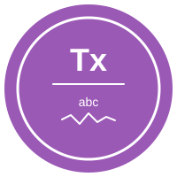

#  TextMaker

TextMaker is a client-side JavaScript tool for generating text variations by filling `{}` placeholders from up to five columns of values. It is mainly used to create batch SQL queries.

## Features

- Up to five value columns
- `{}` placeholders filled in column order
- One output line per input row
- Shorter columns reuse their last value
- Blank input lines are ignored
- Single quotes are doubled for SQL string literals
- Clear error when the query has more placeholders than value columns
- Runs entirely in the browser; no build step and no npm dependencies

## Demo

Live demo: https://textmaker.myridia.com

## How it works

Example query:

```sql
DELETE FROM table1 WHERE name = '{}' AND date = '{}';
```

If column 1 contains:

```text
Alice
Bob
```

and column 2 contains:

```text
2026-11-25
```

the result is:

```sql
DELETE FROM table1 WHERE name = 'Alice' AND date = '2026-11-25';
DELETE FROM table1 WHERE name = 'Bob' AND date = '2026-11-25';
```

Rules:

- one output line per populated row across all columns
- shorter columns reuse their last value
- blank and whitespace-only lines are ignored
- single quotes in values are doubled automatically
- extra `{}` placeholders show an error in the red message area
- a query without `{}` is emitted once

## Task Runner

Run:

```bash
./ask.sh
```

Menu:

```text
1  Check - verify JavaScript and shell syntax
2  Start - Docker (port 80)
3  Start - local HTTP server (port 8080)
4  Stop - Docker services
5  Clean - this project's Docker state
0  Exit
```

Individual tasks can be run directly:

```bash
sh ask.d/start_docker.sh
```

## Installation

No installation is required. Open `public/index.html` directly in a browser.

Optional local server:

```bash
./ask.sh
```

Then choose task `3` and open http://127.0.0.1:8080.

## Files

```text
public/index.html       main page
public/js/app.js        generator logic
public/js/main.js       UI initialization and errors
public/css/app.css      styles
test/generator.test.js  generator tests
dockers/                nginx docker-compose setup
```

## License

This project is licensed under the GNU General Public License v3.0. See [LICENSE](LICENSE).

## Add Repository

```bash
git remote add codeberg ssh://git@codeberg.org/veto/textmaker.git
git push codeberg
```
