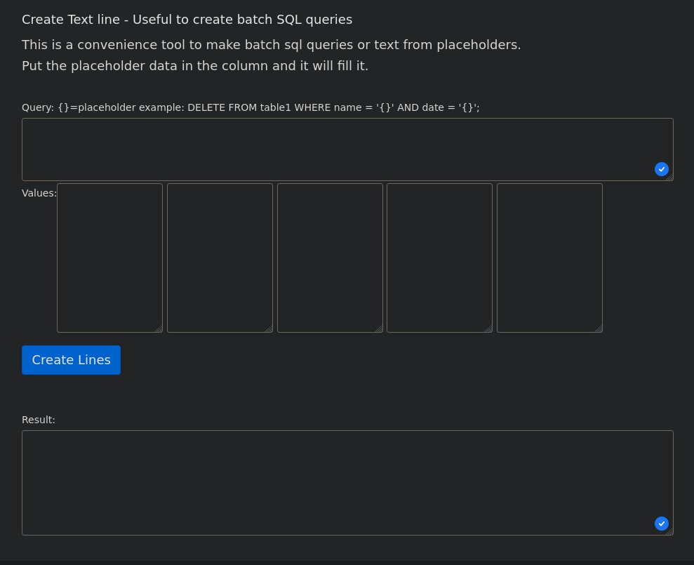

#  TextMaker

TextMaker is a JavaScript project that allows you to sample and combine text lines from up to five columns of data. It's designed to help generate variations of text based on a structured input.


## Features

*   **Multi-Column Input:** Accepts data organized in up to five columns.
*   **Random Sampling:** Randomly selects a line from each column.
*   **Text Combination:** Combines the selected lines into a single output string.
*   **Simple Configuration:** Easy to configure the input data.
*   **Client-Side JavaScript:** Runs entirely in the browser.

## Demo

**Check out the live demo here:** [https://textmaker.myridia.com](https://textmaker.myridia.com)

The demo allows you to experiment with different input data and see how TextMaker generates text in real-time.  You can directly edit the data in the table and click the "Generate" button to see the results.  This is the easiest way to understand how TextMaker works.  The demo also showcases the ability to save and load data from local storage.

## How it works
#  


## Task Runner

Run:

```bash
./ask.sh
```

Menu:

```text
1  Setup - install npm dependencies
2  Start - plain JS via Docker (port 80)
3  Start - local HTTP server (port 8080)
4  Start - Vue dev server
5  Build - Vue production bundle
6  Stop - Docker services
7  Clean - this project's Docker state
0  Exit
```

Individual tasks can be run directly, for example:

```bash
sh ask.d/start_docker.sh
```

## Installation

Since this is a client-side JavaScript project, there's no installation required in the traditional sense. Simply include the necessary files in your HTML.

1.  Download or clone the repository:

    ```bash
    git clone https://github.com/myridia/textmaker.git
    ```

2.  Include the `textmaker.js` file in your HTML:

    ```html
    <script src="textmaker.js"></script>
    ```


## Contributing

Contributions are welcome! Please feel free to submit pull requests with bug fixes, improvements, or new features.

## License

This project is licensed under the **GNU General Public License v3.0**. See the [LICENSE](LICENSE) file for details.  A copy of the license can be found at [https://www.gnu.org/licenses/gpl-3.0.en.html](https://www.gnu.org/licenses/gpl-3.0.en.html).
```

## Add Repository
git remote add codeberg ssh://git@codeberg.org/veto/textmaker.git
git push codeberg
